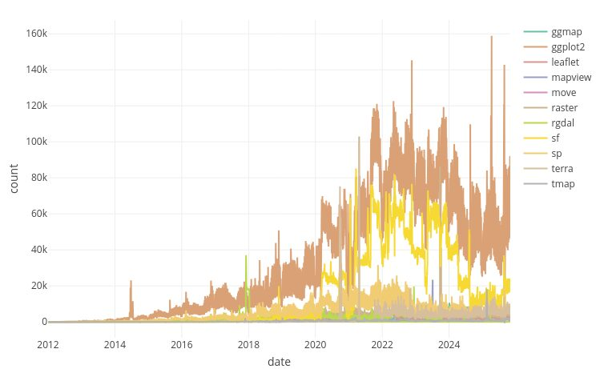
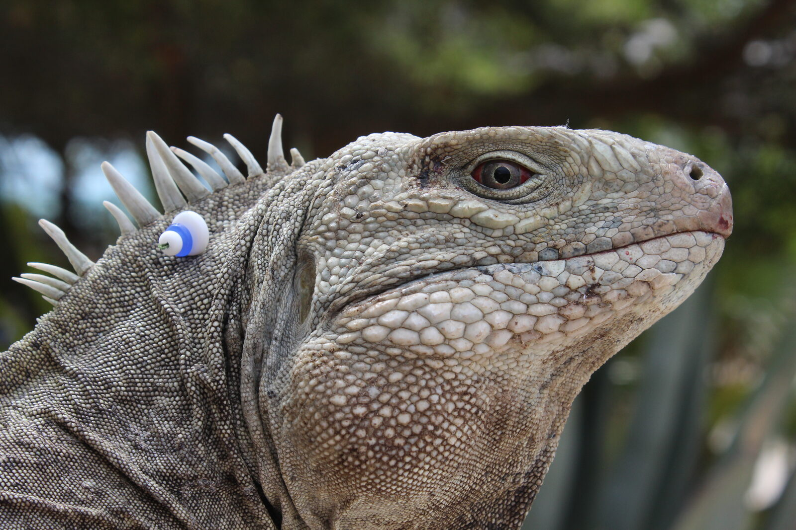
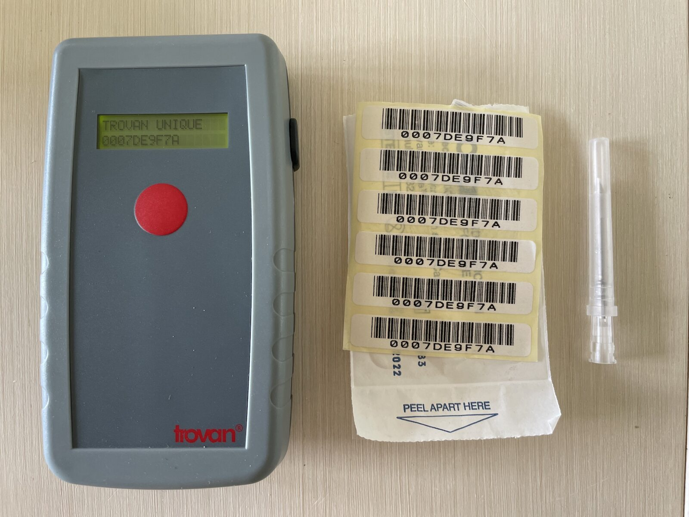
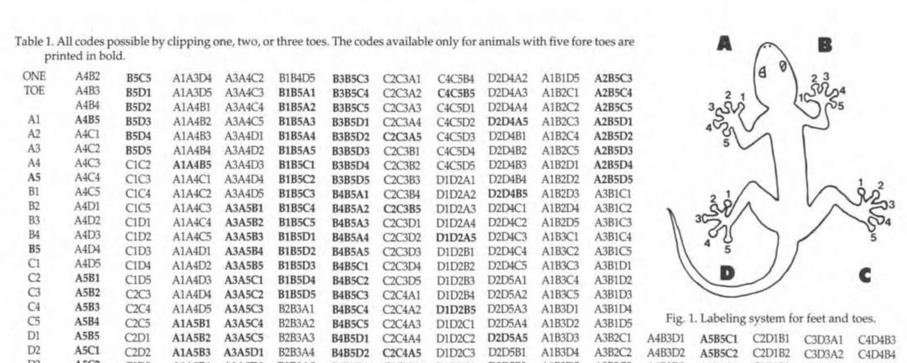
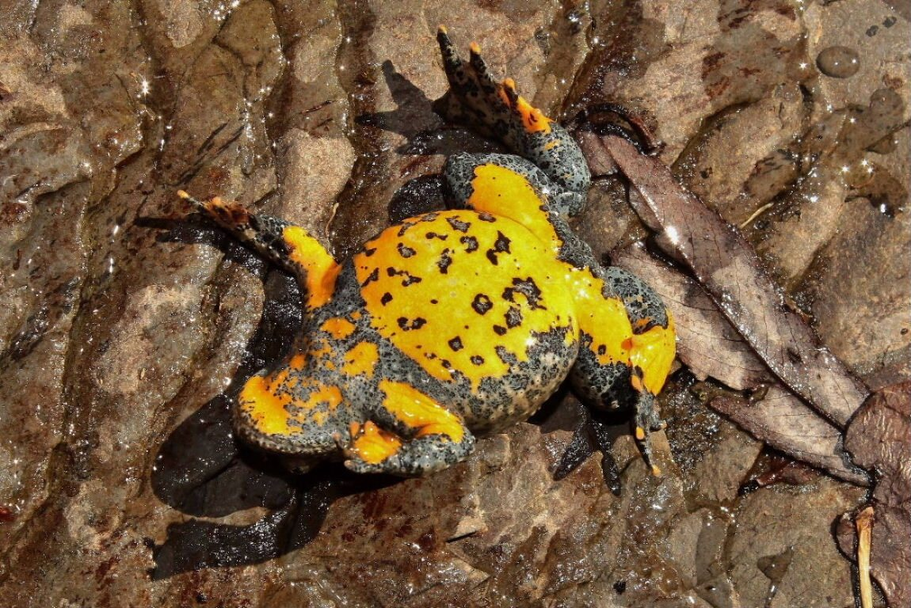
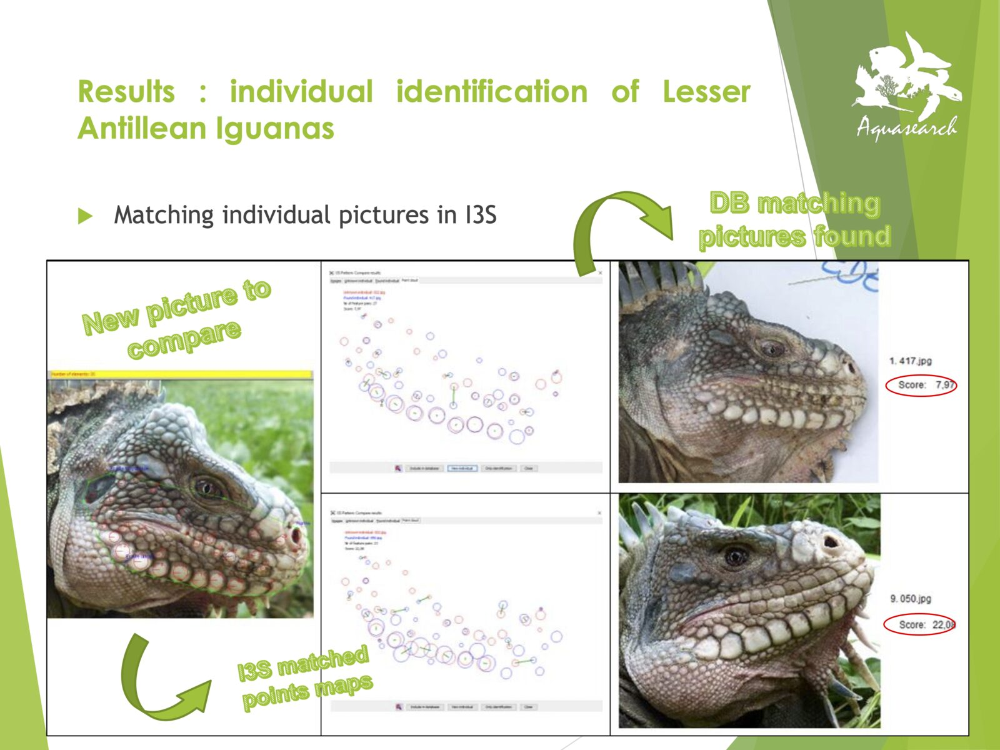
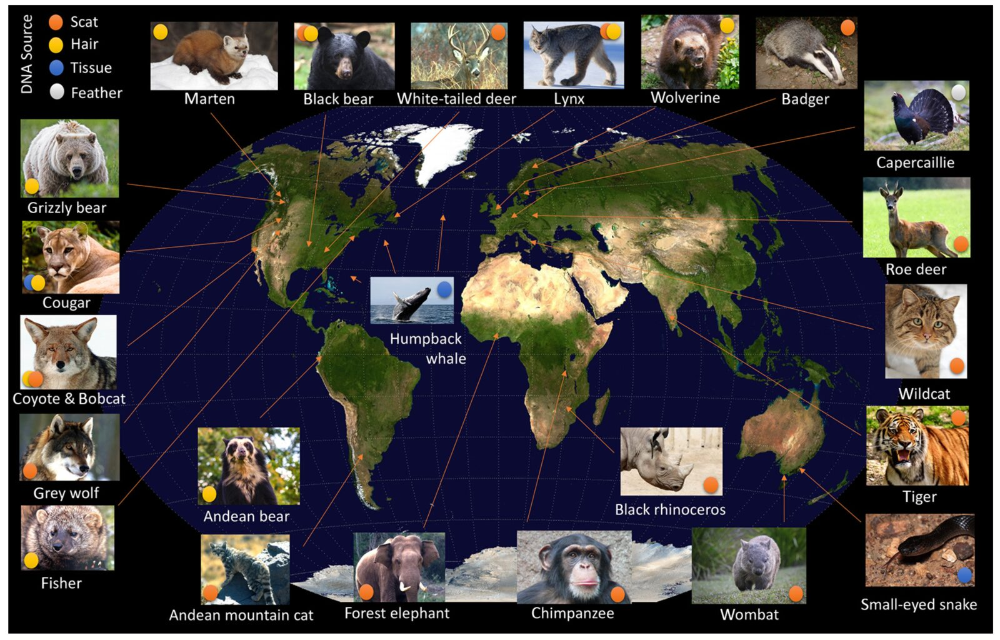
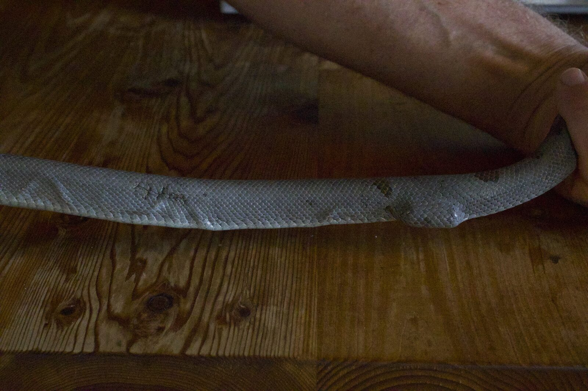
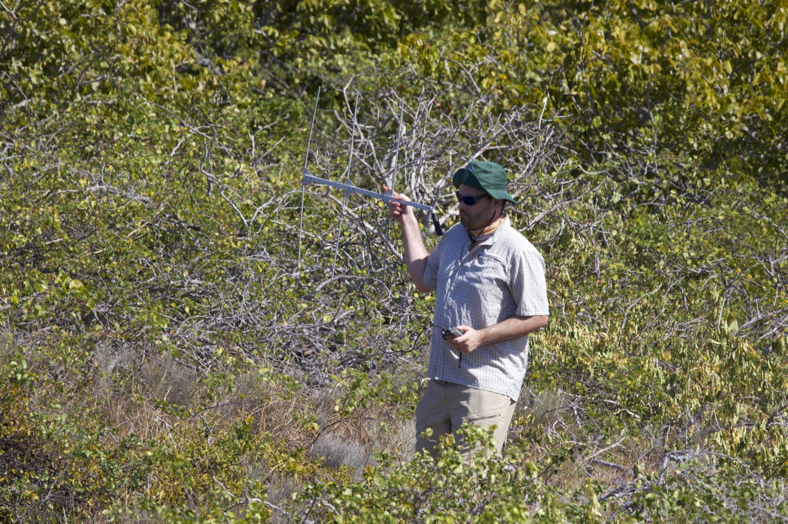
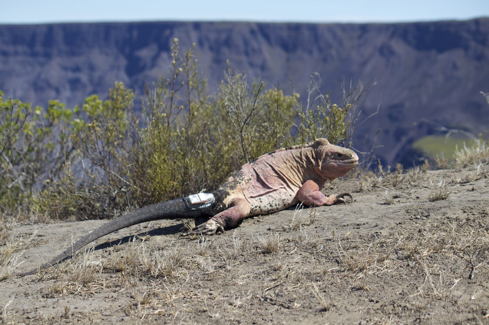

## Where we are going
::: {.objectives}
**By the end of today you will be able to**

1. State the four questions of the movement-ecology paradigm
2. Name the main tracking technologies and pick one for a given species
3. Explain what a *fix* is, and what its error structure looks like
4. Recognise the three biases that ruin tracking datasets
5. Have R running on your laptop
:::

. . .

**The plan for the eight classes**

| | | |
|:--|:--|:--|
| 1 · Movement & tracking | 2 · Spatial data in R | 3 · Tracking data in R |
| 4 · Metrics & home range | 5 · Remote sensing | 6 · Segmentation |
| 7 · RSF | 8 · SSF / iSSA | |

---

## How the quizzes work

Throughout the slides you will meet questions like this one.
**Click an answer.** Nothing is graded, nothing is recorded.

::: {.quiz}
What happens when you click an option?

- [ ] Your answer is sent to the lecturer
- [x] The correct answer and an explanation appear
- [ ] Nothing, the slides are static PDFs

::: {.quiz-feedback}
Exactly — the deck reveals the correct answer(s) in green and unfolds a short
explanation. There is an *"ask again"* button to reset it. Answer honestly:
a wrong answer now is information, a wrong answer in June is a problem.
:::
:::

# 1 · Why movement matters {background-color="#14525a"}

---

## Movement is the link between an animal and its environment

Almost every process a conservation biologist cares about is a movement
process in disguise:

::: {.incremental}
- **Gene flow** — dispersal distances set population connectivity
- **Disease spread** — contact rates are an outcome of where animals go
- **Population persistence** — can individuals reach the next patch?
- **Human–wildlife conflict** — where do animals and people overlap, and when?
- **Protected-area design** — a reserve that does not contain the movements
  it was drawn for does not work
- **Climate response** — range shifts are dispersal events, one individual at a time
:::

. . .

::: {.keyidea}
If you cannot describe how an organism moves, you cannot predict how it will
respond to a changing landscape.
:::

---

## The data deluge

{width="72%" fig-align="center"}

The constraint has moved. It used to be *getting* locations. It is now
*knowing what to do with them*.

---

## The movement ecology paradigm

Nathan *et al.* (2008) reduced the whole field to **four questions** about
every movement path:

::: {.incremental}
1. **Why move?** — the *internal state*. Hunger, thirst, reproduction, fear.
   The motivation.
2. **How to move?** — the *motion capacity*. Legs, wings, fins; the
   biomechanical envelope.
3. **When and where to move?** — the *navigation capacity*. Memory, senses,
   cues, orientation.
4. **What external factors?** — the environment. Landscape, weather,
   predators, other individuals, people.
:::

. . .

::: {.keyidea}
$U_t = f(\Omega, \Phi, r_t, w_t)$ — the observed path is the *joint outcome* of
all four. This is why a track is hard to interpret: many different
combinations produce similar-looking paths.
:::

---

## Lagrangian vs Eulerian

::: {.columns}
::: {.column width="50%"}
### Lagrangian
**Follow the individual.**

Telemetry, biologging, mark-recapture.

*"Where did animal #7 go?"*

Gives you the **process**: the sequence of decisions.
:::

::: {.column width="50%"}
### Eulerian
**Watch a fixed place.**

Camera traps, transects, counts, eDNA.

*"How many animals passed this point?"*

Gives you the **pattern**: density in space.
:::
:::

. . .

This course is almost entirely **Lagrangian** — but remember the two are
linked: a distribution is what you get when you integrate movement over time.

---

## Vocabulary — get this right now
| Term | Meaning |
|:--|:--|
| **Fix** (or *relocation*) | One estimated location **with a timestamp**. The atom of everything. |
| **Track** / **trajectory** | An ordered sequence of fixes for **one individual** |
| **Burst** | A stretch of a track with regular sampling and no big gaps |
| **Step** | The straight segment between two consecutive fixes |
| **Step length (SL)** | Distance of a step. Note: **not** distance travelled |
| **Turning angle (TA)** | Change of direction between consecutive steps |
| **Fix rate** / sampling interval | How often the tag tries to locate |
| **Fix success rate** | Fraction of attempts that produced a location |
| **Deployment** | One tag, on one animal, over one period |

. . .

::: {.keyidea}
A track is **not** the path the animal walked. It is a *sample* of that path.
Everything between two fixes is an assumption.
:::

---

## Quiz

::: {.quiz}
A GPS collar is set to attempt a fix every hour. Over one day it produces 18
locations. The straight-line distances between consecutive fixes sum to 4.1 km.
Which statements are true?

- [ ] The animal travelled 4.1 km that day
- [x] The animal travelled **at least** 4.1 km that day
- [x] The fix success rate was 75%
- [ ] The 6 missing fixes can be safely ignored

::: {.quiz-feedback}
4.1 km is a **lower bound**: the animal's real path between fixes is at least
as long as the straight line, and usually much longer. Summed step length is
scale-dependent — sample twice as often and it grows.

18/24 = 75% success. And the missing fixes are the opposite of ignorable:
GPS failures are *not random*. Fixes fail under canopy, in gorges, in dense
cover — exactly the habitats an animal may be selecting. Missing data are
themselves an ecological signal.
:::
:::

# 2 · How we track animals {background-color="#14525a"}

---

## The toolbox, from cheapest to most expensive

| | Method | Locations? | Typical cost |
|:--|:--|:--|:--|
| 🏷️ | Marks & recapture | Two points, maybe | € |
| 📻 | VHF radio-telemetry | Human-limited | €€ |
| 🛰️ | Argos (Doppler) | 250 m – 10 km | €€€ |
| 📡 | GPS store-on-board | 5–30 m | €€€ |
| 📱 | GPS + GSM / Iridium | 5–30 m, live | €€€€ |
| 💡 | Light-level geolocators | ~100–200 km | €€ |
| 📈 | Accelerometers / IMU | No — *behaviour* | €€ |
| 🔊 | Acoustic telemetry | Receiver range | €€€ |

. . .

::: {.keyidea}
There is no best technology. There is only the best technology **for this
animal, this question, and this budget** — and the animal's body mass usually
decides for you.
:::

---

## Marking individuals: the cheap and enduring methods

::: {.columns}
::: {.column width="50%"}
{width="100%"}
:::
::: {.column width="50%"}
{width="100%"}
:::
:::

Marks give you **recaptures**, not tracks — two or more points separated by a
long, unobserved interval. Cheap, long-lasting, and still the backbone of
demographic work.

---

## Marking: from mutilation to photographs

::: {.columns}
::: {.column width="46%"}
{width="100%"}

Effective, permanent — and now ethically contested. Increasingly replaced.
:::
::: {.column width="54%"}
{width="100%"}

Natural markings cost the animal nothing. Photo-ID software now does the
matching at scale.
:::
:::

---

## Photo-identification at scale

{width="62%" fig-align="center"}

Pattern-matching algorithms turn a shoebox of photographs into a
capture–recapture dataset — for whale sharks, giraffes, newts, iguanas.

---

## Genetic tagging

{width="66%" fig-align="center"}

Hair snags, scats, feathers: the animal is never handled. Biased towards
mid-to-large mobile mammals, because that is where the money and the conflict are.

---

## VHF radio-telemetry

::: {.columns}
::: {.column width="50%"}
{width="100%"}
:::
::: {.column width="50%"}
{width="100%"}
:::
:::

The tag emits a pulse; **you** find it. A location comes from *homing in* or
from **triangulation** of ≥2 bearings. Tags go down to **0.2 g** — nothing
else reaches insects and the smallest bats.

---

## What triangulation actually costs you

::: {.incremental}
- Each bearing has error; the location error is the **intersection polygon**
  of two noisy bearings, and it grows fast with distance
- Data arrive **when a human is in the field** — so nights, storms and
  weekends are systematically under-sampled
- A few dozen to a few hundred fixes per animal, unevenly spaced
- Cheap tags, expensive *fieldwork*
:::

. . .

::: {.keyidea}
The bat dataset we will use in Class 3 is exactly this: 17 individuals,
1,740 fixes *in total*, wildly irregular. Most methods in this course assume
regular sampling. Part of your training is learning to say **"not with these
data"**.
:::

---

## GPS: trilateration

{width="42%" fig-align="center"}

::: {.incremental}
- Each satellite broadcasts its position and a very precise time
- Distance to a satellite = (signal travel time) × c
- **3 satellites** fix a position in principle; a **4th** is needed to solve
  the receiver's clock error — and more give altitude and redundancy
:::

---

## GPS in practice, on an animal
::: {.columns}
::: {.column width="55%"}
**What you get**

- Horizontal error typically **5–30 m** under open sky
- A quality flag: number of satellites, **DOP** (dilution of precision), 2D vs 3D fix
- Optional altitude, speed, temperature, activity

**What it costs**

- A **cold start** (no recent almanac) can take minutes and drain the battery
- Canopy, canyons, burrows and water block the signal
- Energy scales with fix rate — this is the central design trade-off
:::
::: {.column width="45%"}
{width="100%"}
:::
:::

---

## Getting the data off the animal

::: {.incremental}
- **Store-on-board** — cheapest, best battery use, but you must **recapture**
  the animal. Lose the animal, lose everything.
- **VHF/UHF download** — get close, pull the data over the air
- **GSM / SMS** — near-live data wherever there is mobile coverage. Fails in
  exactly the remote places you care about.
- **Iridium / Argos uplink** — global, live, expensive, small data volumes
- **Drop-off collars** — timed or remotely triggered release, then go and find
  the collar. Elegant, and one more thing that can fail.
:::

. . .

::: {.keyidea}
Ask *"how will I get the data back?"* **before** you buy the tags. This is the
question most first projects get wrong.
:::

---

## Argos, geolocators, and the aquatic world
::: {.columns}
::: {.column width="33%"}
### Argos
Satellites measure the **Doppler shift** of the tag's transmission.

Error classes 3 → B: **~250 m to >10 km**.

Global, works at sea, decades of history. Still standard for sea turtles,
seabirds, pinnipeds.
:::
::: {.column width="33%"}
### Geolocators (GLS)
Log **light level**. Day length → latitude; time of local noon → longitude.

Error **100–200 km**. Useless near equinox.

But: ~0.3 g. For small migratory birds it is the *only* option.
:::
::: {.column width="33%"}
### Acoustic telemetry
Tag pings; **fixed hydrophones** listen.

You get detections at receivers, not positions — a **network** problem,
not a trajectory problem.

Fish, sharks, invertebrates.
:::
:::

---

## Biologging: sensors that are not locations

::: {.incremental}
- **Tri-axial accelerometers** — the workhorse. At 10–50 Hz you can classify
  feeding, resting, flying, and estimate energy expenditure (ODBA)
- **Magnetometers + gyroscopes** — heading and body rotation; combined with
  accelerometers gives **dead reckoning**: a fine-scale path between GPS fixes
- **Pressure / depth** — dive profiles
- **Temperature, heart rate, gut temperature** — physiology in the wild
- **Proximity tags** — who was near whom, and for how long: social networks
:::

. . .

::: {.keyidea}
The frontier is not more locations. It is **locations plus sensors**: knowing
*where* **and** *what the animal was doing there*. Class 6 is the statistical
version of this question when all you have is the trajectory.
:::

---

## Quiz

::: {.quiz}
You must study the migratory route of a 22 g passerine that breeds in Italy
and winters somewhere in sub-Saharan Africa. Individuals return to the same
nest box each spring. Which technology?

- [ ] GPS/GSM collar
- [x] Light-level geolocator
- [ ] Argos PTT
- [ ] VHF radio-telemetry

::: {.quiz-feedback}
The **5% rule** decides it: the tag should stay under ~5% of body mass, so
~1.1 g here. That excludes GPS/GSM and Argos PTTs outright. VHF has no
transcontinental range.

A geolocator weighs a few tenths of a gram. Its 100–200 km error would be
useless for home-range work but is irrelevant for a 4,000 km migration.

And crucially: geolocators are **store-on-board**, so the whole design depends
on the birds' nest-box philopatry — you must **recapture** them. That is not a
detail, it is the study.
:::
:::

---

## Choosing: the trade-off table
| | Accuracy | Min. mass | Data return | Temporal coverage |
|:--|:--|:--|:--|:--|
| Marks / PIT | Point of capture | ~0.1 g | On recapture | Sparse |
| VHF | 10s–100s m | **0.2 g** | Manual, live | Human-limited |
| Geolocator | 100–200 km | **0.3 g** | On recapture | Continuous |
| Argos | 250 m – 10 km | ~5 g | Remote, global | Good |
| GPS store-on-board | 5–30 m | ~1 g | On recapture | Programmable |
| GPS + GSM | 5–30 m | ~15 g | Remote, live | Programmable |
| Accelerometer | — (behaviour) | ~0.5 g | Usually on recapture | Very high rate |

::: {.keyidea}
Read this table **right to left**. Start from "how do I get the data back and
how much does the animal weigh", not from "what accuracy would be nice".
:::

# 3 · Doing it responsibly {background-color="#14525a"}

---

## Tag effects are real

::: {.incremental}
- The **5% rule** (tag ≤ 5% of body mass) is a *convention*, not a finding.
  Portugal & White (2018) showed miniaturisation has not actually made
  published studies lighter relative to body mass.
- For flying and diving animals, **drag and shape matter more than mass**.
  A streamlined 3% package can beat a bluff 1.5% one.
- Documented effects: reduced breeding success, higher energy expenditure,
  altered diving, changed social status, injury at the attachment site.
- Effects are often **delayed** — and studies are rarely designed to detect them.
:::

. . .

::: {.keyidea}
A tagged animal is, to some degree, a *modified* animal. The honest position
is to minimise, measure and report the effect — not to assume it away.
:::

---

## Ethics and permits: the checklist

::: {.incremental}
1. **Is the question worth it?** Would existing data answer it?
2. **3 Rs** — replace, reduce, refine. The smallest sample that can answer the question.
3. **Ethics approval** and national/regional permits, *before* fieldwork.
   In Italy: ISPRA and regional authorisations; EU Directive 2010/63 where applicable.
4. **Capture and handling** protocol, anaesthesia where required, trained personnel.
5. **Attachment** — weak links and planned drop-offs so nothing is worn forever.
6. **Data sensitivity** — for poached species, publishing exact coordinates can
   be lethal. Movebank supports embargo and coarsening.
7. **Report the effects you observed**, including the animals you lost.
:::

---

## Quiz

::: {.quiz}
Which of these is the *strongest* argument for choosing a 30-minute fix
interval over a 5-minute one, for a study of buffalo habitat selection?

- [ ] 30-minute data are more accurate
- [x] It extends the deployment over a whole year, capturing seasonal variation
- [ ] Statistical software cannot handle 5-minute data
- [ ] 30 minutes is the standard for ungulates

::: {.quiz-feedback}
Fix interval is a **battery** decision, and therefore a decision about *how
long* you observe. 5-minute data over six weeks and 30-minute data over a year
answer different questions — and for seasonal habitat selection, the year wins.

Accuracy per fix does not change with rate. Software is not the constraint.
And "it's the standard" is never a reason — it is a description of what other
people's batteries could manage.

The real cost: coarse sampling **truncates** the step-length distribution.
You will see this bite in Classes 4 and 8.
:::
:::

# 4 · The three biases {background-color="#14525a"}

---

## Bias 1 — Fix success is not random

::: {.incremental}
- GPS fixes fail under **dense canopy**, in **steep terrain**, in **burrows**,
  underwater
- So the fixes you *have* are biased towards open habitat
- Then you fit a habitat-selection model and conclude the animal prefers
  open habitat
- **You have measured your collar, not your animal**
:::

. . .

::: {.keyidea}
Fixes are missing *because of* the covariate you are modelling. This is
missing-not-at-random, the nastiest kind. Mitigation: stationary test
collars in each habitat type, and model fix success explicitly.
:::

---

## Bias 2 — Location error is structured

::: {.incremental}
- Error is **not** independent white noise: it is correlated in time and
  correlated with habitat
- A bad fix can place an animal hundreds of metres away, producing an
  implausible step out and an implausible step back — a **spike**
- Naïvely, that spike inflates your speed distribution and your home range
- Filtering on speed is the standard fix, but a threshold that is too
  aggressive deletes real fast movement
:::

. . .

Keep the DOP / satellite-count columns. They are your evidence about which
fixes to distrust. We use them in Class 3.

---

## Bias 3 — The sample of animals

::: {.incremental}
- Tagged animals are the ones you could **catch**: often bolder, often in
  accessible places, often adults, often one sex
- Sample sizes are small — 6 buffalo, 1 vulture. Individual variation is
  large, and $n=1$ tells you about *that individual*
- Tags fail unevenly: animals in rough habitat lose collars more often,
  so late in a study your sample has drifted
- Publication bias: dispersal studies report the animals that were *found*
:::

. . .

::: {.keyidea}
Three questions for every tracking paper you read, including yours:
**Which animals? Which fixes? What is missing, and why?**
:::

---

## Quiz

::: {.quiz}
A study reports that collared deer "avoid dense forest", based on GPS collars
with an overall fix success of 62%. What is the first thing you should check?

- [ ] Whether the sample size was large enough
- [x] Whether fix success itself differed between forest and open habitat
- [ ] Whether the collars were calibrated
- [ ] Whether the study was peer-reviewed

::: {.quiz-feedback}
A 38% failure rate is enormous, and canopy is the classic cause of GPS
failure. If the collar fails more often under trees, forest locations are
under-represented in the data *by construction* — and "avoidance" is an
artefact of the instrument.

Sample size does not help: more collars with the same bias give you a more
precise wrong answer. The standard remedy is stationary test collars deployed
across habitat types to estimate habitat-specific fix rates, then weight or
model accordingly.
:::
:::

# 5 · Where the data live {background-color="#14525a"}

---

## Movebank

[movebank.org](https://www.movebank.org) — the field's shared repository.

::: {.incremental}
- Thousands of studies, billions of locations; many openly licensed
- A **controlled vocabulary**: `timestamp`, `location-long`, `location-lat`,
  `individual-local-identifier` — always the same names, always UTC, always WGS84
- **Env-DATA**: upload a track, get it annotated with weather, NDVI, land
  cover, elevation. We do this by hand in Class 5 so you understand what it does.
- R access through the `move2` package
:::

. . .

Our three datasets all come from there — see the [Datasets page](../../data.qmd).

---

## Today's exercise

::: {.objectives}
**[→ Class 1 exercise](exercise.qmd)**

1. Check that R, RStudio and the course packages work
2. Read a real Movebank file and look at what is actually in it
3. Compute a first fix rate and a first fix success rate
4. Plot your first trajectory — with no spatial packages at all
:::

. . .

::: {.keyidea}
Today's plot will be *wrong* in an instructive way: it treats longitude and
latitude as if they were plane coordinates. Fixing that is Class 2.
:::

---

## Recap

::: {.incremental}
- Movement links the individual to the landscape; four questions (Nathan et al.)
- A **fix** is a timestamped location estimate; a **track** is a *sample* of a path
- Technology choice is driven by **body mass** and **data recovery**, not by
  desired accuracy
- Tags affect animals; the 5% rule is a convention, not a guarantee
- Three biases: **fix success**, **location error**, **which animals you caught**
:::

. . .

### Before Class 2

- Finish the [setup page](../../setup.qmd) — `sf` and `terra` must install cleanly
- Read Nathan et al. (2008), PNAS 105:19052 — it is 8 pages
- Skim the [Datasets page](../../data.qmd)

---

## {.center}

### Questions?

[giuliano.colosimo@uniroma2.it](mailto:giuliano.colosimo@uniroma2.it)

Slides, code and data: [github.com/GiulianoColosimo/animtrack-2627](https://github.com/GiulianoColosimo/animtrack-2627)
