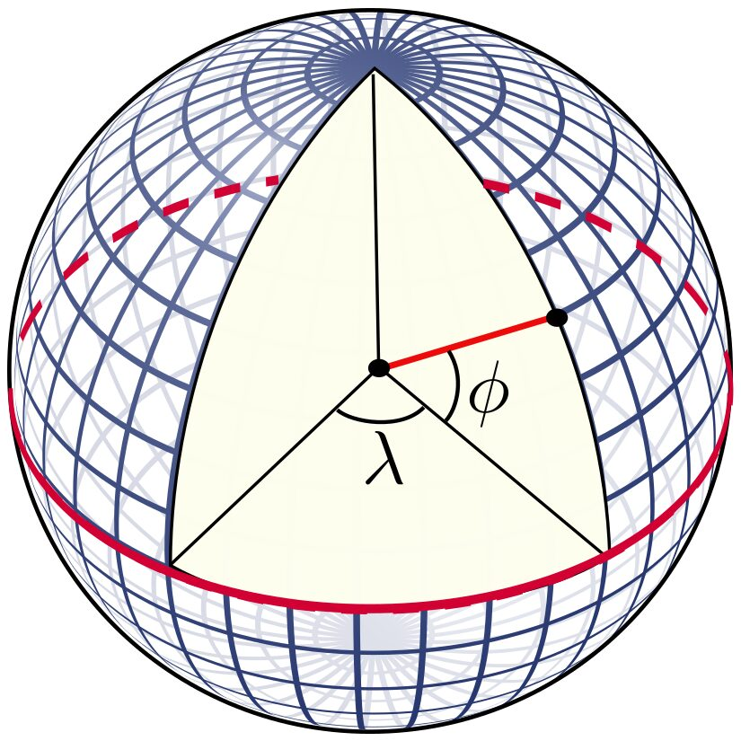
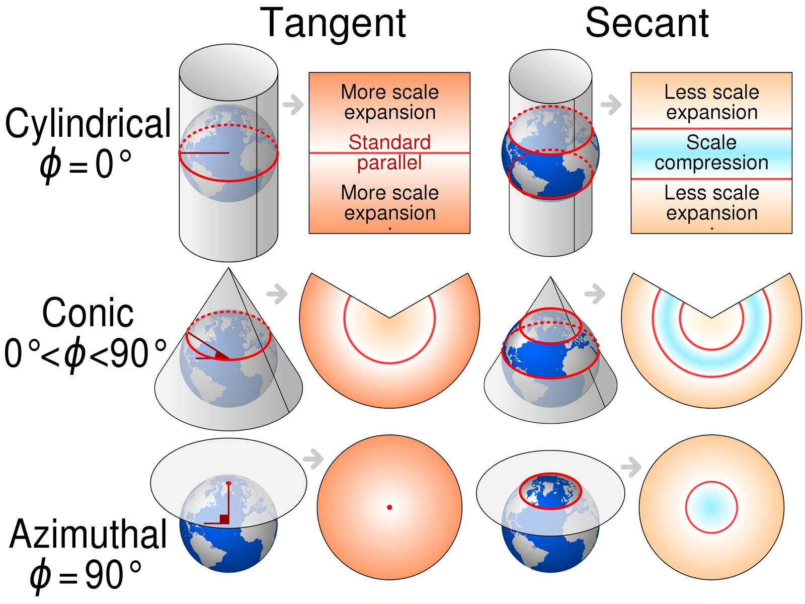

## Today

::: {.objectives}
1. The two data models: **vector** and **raster**
2. What a **coordinate reference system** is, and why every bug you will have
   this term is a CRS bug
3. Geographic vs projected coordinates; UTM; EPSG codes
4. The two packages: **`sf`** for vector, **`terra`** for raster
5. Turn the buffalo CSV into a real spatial object and measure something in metres
:::

. . .

::: {.keyidea}
Last week's trajectory plot was distorted because we treated degrees as if
they were metres. Today we fix that properly.
:::

# 1 · Two ways to represent the world {background-color="#14525a"}

---

## Vector and raster

::: {.columns}
::: {.column width="50%"}
### Vector
Discrete objects with **coordinates**.

- **Point** — a fix, a nest, a trap
- **Line** — a trajectory, a river, a road
- **Polygon** — a home range, a park boundary, a lake

Each object carries an **attribute table**.

Exact geometry, arbitrary precision.
:::
::: {.column width="50%"}
### Raster
A **regular grid** of cells, each with a value.

- Elevation, NDVI, temperature, land cover
- Defined by origin, cell size, number of rows/cols, CRS

Continuous surfaces, fixed resolution.

Fast maths, no notion of individual objects.
:::
:::

. . .

::: {.keyidea}
Movement analysis is nearly always **points (or steps) sampling rasters**.
That one sentence describes Classes 5, 7 and 8.
:::

---

## Choosing the model

| Question | Model |
|:--|:--|
| Where exactly was the animal at 08:00? | Vector (point) |
| What is the NDVI there? | Raster, sampled at that point |
| What is the park boundary? | Vector (polygon) |
| How far is the nearest river? | Raster (a distance surface) or vector + distance computation |
| How much forest within 500 m? | Raster, summarised in a buffer |

. . .

The same reality can be either. A river is a **line** if you care about its
course, and a **distance-to-river raster** if you care about how far the
animal is from it. Choose by the operation you need, not by what the thing
"is".

# 2 · Coordinate reference systems {background-color="#14525a"}

---

## The problem

The Earth is a lumpy ellipsoid. Maps and computer screens are flat. Getting
from one to the other requires choices, and **every choice distorts something**.

. . .

A CRS answers three questions:

::: {.incremental}
1. **What shape is the Earth?** — the *ellipsoid* (e.g. WGS84, GRS80)
2. **How is that shape tied to the actual planet?** — the *datum*
3. **How do we flatten it?** — the *projection* (or none, if we keep angles)
:::

---

## Geographic coordinates

{width="55%" fig-align="center"}

Latitude: angle north/south of the equator. Longitude: angle east/west of
Greenwich. Units are **degrees**. This is what every GPS and every Movebank
file gives you — usually **WGS84, EPSG:4326**.

---

## Why you cannot do arithmetic with degrees

::: {.incremental}
- One degree of **latitude** ≈ 111 km everywhere
- One degree of **longitude** ≈ 111 km × cos(latitude)
  - at the equator: 111 km
  - at 24° (Kruger): ~102 km
  - at 46° (Switzerland): ~77 km
  - at the pole: 0 km
:::

. . .

```r
# WRONG — mixes two different units
sqrt((x2 - x1)^2 + (y2 - y1)^2)
```

::: {.keyidea}
Euclidean distance on longitude/latitude is meaningless. You either
**project** to a metric CRS, or compute **great-circle** distances on the
ellipsoid. `sf` does the second automatically for EPSG:4326 — which is safe,
but slower, and does not fix your *plots*.
:::

---

## Projected coordinates

{width="62%" fig-align="center"}

**Conformal** keeps angles/shape (Mercator, UTM). **Equal-area** keeps area
(Albers, Mollweide). **Equidistant** keeps distances from a point.
*No projection keeps everything.*

---

## UTM: the practical default

::: {.incremental}
- The world is cut into **60 zones**, each 6° of longitude wide
- Each zone gets its own transverse Mercator projection, so distortion inside
  a zone is small (< 0.1%)
- Coordinates in **metres**: easting and northing
- Kruger is in zone **36S** → EPSG:**32736**
- Switzerland is in zone **32N** → EPSG:**32632**
:::

. . .

::: {.keyidea}
UTM works beautifully **inside one zone**. Leo the vulture crosses many zones
and 47° of latitude, so no single UTM zone fits him. For continental-scale
tracks use an equal-area CRS suited to the region — or work in geographic
coordinates with geodesic distances.
:::

---

## EPSG codes — the vocabulary you need

| EPSG | What | Units |
|:--|:--|:--|
| **4326** | WGS84 geographic — GPS, Movebank | degrees |
| **3857** | Web Mercator — Google/OSM basemaps. *Never for analysis* | metres |
| **32736** | UTM zone 36S — Kruger | metres |
| **32632** | UTM zone 32N — Switzerland, Italy | metres |
| **3035** | ETRS89 / LAEA Europe — equal-area, continental | metres |
| **6933** | WGS84 / NSIDC EASE-Grid 2.0 Global — equal-area, global | metres |

. . .

::: {.callout-warning appearance="simple"}
**3857 is a trap.** It is conformal, wildly non-equal-area, and areas near the
poles are inflated by orders of magnitude. Use it to *display* tiles, never to
compute a home range.
:::

---

## Quiz

::: {.quiz}
You have buffalo fixes in EPSG:4326 and you want the area of a 95% home range
polygon, in km². What is the right sequence?

- [ ] Compute the polygon in 4326, then convert degrees² to km²
- [x] Transform the points to EPSG:32736, compute the polygon, read the area in m²
- [ ] Transform to EPSG:3857, compute the polygon, read the area in m²
- [ ] Compute the polygon in 4326 — `sf` handles it automatically

::: {.quiz-feedback}
Project **first**, to a CRS whose units are metres and which is appropriate
for the region — UTM 36S for Kruger. Then all the geometry operations are
ordinary plane geometry and areas come out in m².

There is no fixed conversion from degrees² to km²: the factor depends on
latitude. Web Mercator (3857) has units of metres but is *not* equal-area, so
areas are systematically wrong. And while `sf` can compute geodesic *lengths*
and *areas* on 4326, kernel-density home-range estimators need projected
coordinates — they assume a plane.
:::
:::

# 3 · `sf` — vector data {background-color="#14525a"}

---

## The idea behind `sf`

A **simple feature** data frame is an ordinary data frame with one extra
column, `geometry`, that holds the coordinates — and a CRS attached.

```{r}
#| echo: fenced
library(sf)

pts <- data.frame(
  id = c("a", "b"),
  lon = c(31.76, 31.80),
  lat = c(-24.54, -24.50)
)

pts_sf <- st_as_sf(pts, coords = c("lon", "lat"), crs = 4326, remove = FALSE)
pts_sf
```

---

## Everything else is dplyr

Because it *is* a data frame, all your usual verbs work, and the geometry
comes along for the ride.

```{r}
#| echo: fenced
library(dplyr)

pts_sf |>
  mutate(label = toupper(id)) |>
  filter(lat > -24.52) |>
  select(id, label)
```

. . .

Note the geometry column survives `select()` without being named — it is
"sticky". Use `st_drop_geometry()` when you genuinely want a plain data frame.

---

## The functions you will actually use
| Function | What it does |
|:--|:--|
| `st_as_sf()` | data frame → spatial |
| `st_crs()` | get/set the CRS. **Setting ≠ transforming** |
| `st_transform()` | reproject to another CRS |
| `st_coordinates()` | pull the coordinates back out as a matrix |
| `st_distance()` | distances between features |
| `st_buffer()` | a polygon at a fixed distance around features |
| `st_bbox()` | bounding box |
| `st_intersection()`, `st_union()` | overlay operations |
| `st_write()` / `st_read()` | GeoPackage, shapefile, GeoJSON… |

---

## `st_crs()` vs `st_transform()` — the classic bug

::: {.columns}
::: {.column width="50%"}
### `st_crs(x) <- 32736`
*"These numbers were always UTM; I am just writing down the label."*

If the numbers are actually degrees, you have now **lied** to R. The points
land near the origin off West Africa.
:::
::: {.column width="50%"}
### `st_transform(x, 32736)`
*"These numbers are in the current CRS; compute the corresponding UTM
coordinates."*

The numbers **change**. This is almost always what you want.
:::
:::

. . .

::: {.keyidea}
Assign a CRS only when the data arrived **without** one and you know what it
should be. Otherwise, transform.
:::

---

## Quiz

::: {.quiz}
Your colleague sends a CSV of coordinates like `x = 375051, y = 7285726` and
says "they're from Kruger". What are they, and what do you do?

- [ ] Longitude/latitude — use `crs = 4326`
- [x] UTM 36S metres — set `crs = 32736` with `st_as_sf()`, do not transform
- [ ] Web Mercator — set `crs = 3857`
- [ ] Impossible to know

::: {.quiz-feedback}
Magnitudes give it away. Longitude and latitude are bounded by ±180 and ±90,
so six- and seven-digit values cannot be degrees. Values of that size in
metres with a large northing are classic **UTM**, and Kruger is zone 36S
(EPSG:32736) — the 7,285,726 m northing is the southern-hemisphere false
northing at ~24.5°S.

Because the numbers are *already* UTM, you **declare** the CRS when building
the `sf` object (`crs = 32736`) rather than transforming. Transforming would
treat metres as degrees.

Sanity check afterwards: `st_transform(x, 4326)` and confirm you land at
roughly 31.8°E, 24.5°S.
:::
:::

# 4 · `terra` — raster data {background-color="#14525a"}

---

## A raster is a grid plus metadata

```{r}
#| echo: fenced
library(terra)

r <- rast(nrows = 4, ncols = 6,
          xmin = 31.5, xmax = 32.1, ymin = -24.8, ymax = -24.4,
          crs = "EPSG:4326")
values(r) <- 1:ncell(r)
r
```

---

## What defines a raster
::: {.incremental}
- **Extent** — xmin, xmax, ymin, ymax
- **Resolution** — cell size in CRS units. `res(r)`
- **Dimensions** — rows × columns × layers. `dim(r)`
- **CRS** — same concept as for vectors
- **Values** — one per cell per layer, possibly `NA`
:::

. . .

A multi-layer raster (`SpatRaster` with several layers) is how you store a
**time series**: one NDVI layer per 16-day composite, stacked. That is
exactly what we need in Class 5.

---

## The `terra` functions you will use
| Function | What it does |
|:--|:--|
| `rast()` | create or read a raster |
| `crop()` / `mask()` | cut to an extent / to a polygon |
| `project()` | reproject (**note:** not `st_transform`) |
| `extract()` | **sample raster values at points** — the key operation |
| `aggregate()` / `resample()` | change resolution |
| `terrain()` | slope, aspect, from elevation |
| `distance()` | distance-to-feature surface |
| `global()`, `zonal()` | summaries |
| `writeRaster()` | save, usually GeoTIFF |

. . .

::: {.keyidea}
`extract()` is the bridge between the movement world and the environment
world. Almost everything in Classes 5–8 passes through it.
:::

---

## Rasters and vectors must agree

Before `extract()`, three things must line up:

::: {.incremental}
1. **Same CRS.** If both objects *carry* a CRS, `terra` transforms for you and
   warns. If either lacks one — a bare coordinate matrix — it assumes they match.
2. **Overlapping extents.** Non-overlap gives you a column of `NA`, not an error.
3. **Appropriate resolution.** Extracting a 1 km NDVI cell for a fix with 10 m
   GPS error is fine. Extracting a 10 m Sentinel pixel for an Argos fix with
   5 km error is self-deception.
:::

. . .

::: {.keyidea}
**Match the resolution of your environmental data to the error of your
locations.** A pixel finer than your positional error adds noise, not
information.
:::

---

## Quiz

::: {.quiz}
You run `terra::extract(ndvi, cbind(buffalo$lon, buffalo$lat))` and **every**
value comes back `NA`. The NDVI raster is in UTM 36S. What happened?

- [x] A bare coordinate matrix carries no CRS, so `terra` assumed the degrees were already metres
- [ ] `terra` always errors on a CRS mismatch, so this cannot happen
- [ ] The NDVI raster is empty
- [ ] You must call `crop()` before `extract()`

::: {.quiz-feedback}
Modern `terra` is helpful **when it can be**: give it a `SpatVector` or an
`sf` object that carries a CRS, and it transforms your points for you,
printing a warning:

```
[extract] transforming vector data to the CRS of the raster
```

But a plain two-column **matrix has no CRS**. `terra` can only assume the
numbers are already in the raster's coordinate system — so 31.8 and −24.5 are
read as *metres*, land far outside the extent, and every lookup returns `NA`.

The same silent failure happens if the CRS of either object is missing
(`crs(r) <- ""`). Lesson: **keep your data in objects that carry their CRS**,
and never strip coordinates down to a bare matrix just to pass them along.
:::
:::

---

## Today's exercise

::: {.objectives}
**[→ Class 2 exercise](exercise.qmd)**

1. Turn the buffalo CSV into an `sf` object
2. Reproject to UTM 36S and see the numbers change
3. Measure the same distance three ways — and get three answers
4. Build a raster, extract values at the fixes
5. Make a map that is not distorted
:::

---

## Recap

::: {.incremental}
- **Vector** = objects with coordinates; **raster** = a grid of values
- A **CRS** = ellipsoid + datum + projection. EPSG codes name them
- Degrees are **angles**: no Euclidean arithmetic, no KDE, no plotting with `asp = 1`
- `st_crs()` **labels**; `st_transform()` **converts**. Know which you need
- `sf` for vector, `terra` for raster, `extract()` to join them
:::

. . .

### Before Class 3

- Read [Geocomputation with R, ch. 2 and 7](https://r.geocompx.org/)
- Make sure `library(move2)`, `library(amt)` and `library(mapview)` all load
